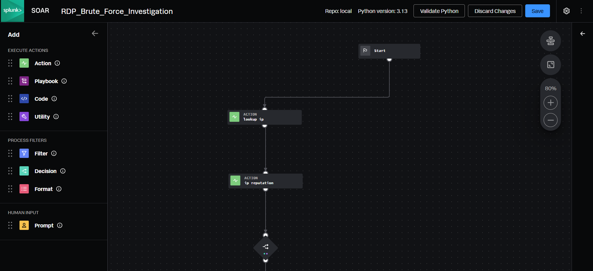
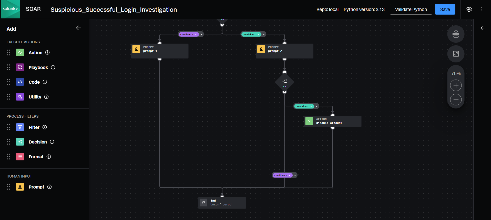
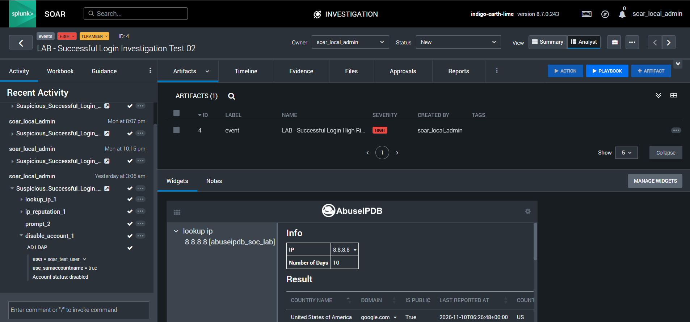

# Splunk SOAR Automated Incident Response

A hands-on SOC automation lab using **Splunk SOAR, AbuseIPDB, VirusTotal, and Active Directory** to enrich source IP addresses, prioritize investigations, and demonstrate analyst-approved account containment.

> **Scope:** Controlled educational lab. The repository contains two playbooks exported as Python and JSON, plus six screenshots. It demonstrates workflow design and a successful test-account disable action; it does not establish a production detection pipeline or a real account compromise.

## Architecture

```text
SOAR container artifacts: cef.sourceAddress
                  |
       AbuseIPDB: lookup ip (10 days)
                  |
       VirusTotal: ip reputation
                  |
          Reputation decision
          /                 \
 RDP investigation      Successful-login investigation
 Update severity        Analyst review / approval
 and tags                       |
                         Explicit Yes on high-risk path
                                |
                         AD LDAP: disable account
                         Fixed target: soar_test_user
```

The screenshots show Splunk SOAR version **8.7.0.243** and a playbook editor using Python **3.13**. These are captured lab versions, not compatibility guarantees.

| Integration | Asset referenced by the exports | Purpose |
|---|---|---|
| AbuseIPDB | `abuseipdb_soc_lab` | Source IP reputation lookup with a 10-day window |
| VirusTotal | `virustotal_soc_lab` | IP reputation and malicious analysis count |
| Active Directory LDAP | `ad_ldap_soc_lab` | Disable the disposable lab account |
| SOAR community custom function | `community/container_update` | Update RDP investigation severity, status, and tags |

## Playbook 1 — RDP Brute Force Investigation

[Python export](playbooks/RDP_Brute_Force_Investigation/RDP_Brute_Force_Investigation.py) · [JSON export](playbooks/RDP_Brute_Force_Investigation/RDP_Brute_Force_Investigation.json)

1. Read non-null `artifact:*.cef.sourceAddress` values.
2. Query AbuseIPDB, then VirusTotal.
3. Evaluate **AbuseIPDB abuseConfidenceScore >= 75 OR VirusTotal malicious count >= 5**.
4. If matched, set severity to **high**, status to **open**, and tags to `rdp_bruteforce, threat_intel_high_risk`.
5. Otherwise, set severity to **medium**, status to **open**, and tags to `rdp_bruteforce, threat_intel_low_risk`.

This playbook enriches an existing investigation. It does not count failed logons, independently detect RDP brute force, block IPs, or disable accounts. The low-risk tag means the configured threshold was not met; it does not establish that an IP is safe.

## Playbook 2 — Suspicious Successful Login Investigation

[Python export](playbooks/Suspicious_Successful_Login_Investigation/Suspicious_Successful_Login_Investigation.py) · [JSON export](playbooks/Suspicious_Successful_Login_Investigation/Suspicious_Successful_Login_Investigation.json)

1. Enrich source IP artifacts using the same two services.
2. Evaluate **AbuseIPDB abuseConfidenceScore >= 80 OR VirusTotal malicious count >= 5**.
3. On the high-risk path, ask `soar_local_admin` to authorize disabling the disposable account. The prompt explicitly states that reputation alone does not confirm compromise.
4. Only an exact **Yes** response reaches the AD LDAP `disable account` action.
5. The action uses the fixed account `soar_test_user` with `use_samaccountname=true`.
6. On the other path, ask whether further investigation is required. That prompt has no automated follow-up action in the export.

Both prompts specify a 30-minute response window. The code has no explicit timeout-handling branch. A non-Yes response to the containment prompt has no connected disable action.

**Target limitation:** The account is hard-coded, not extracted from the login artifact. The workflow does not establish that the source IP belongs to that account or independently validate whether a successful login occurred.

## Evidence and observed results

All six images are available under [screenshots/](screenshots/). Workflow diagrams show configured logic; they are not execution logs.

| Evidence | What is visible |
|---|---|
| [01 — Playbooks overview](screenshots/01-playbooks-overview.png) | Both project playbooks are listed as inactive; the list displays zero success/failure counters |
| [02 — RDP workflow, part 1](screenshots/02-rdp-playbook-workflow-part1.png) | Sequential reputation lookups and decision |
| [03 — RDP workflow, part 2](screenshots/03-rdp-playbook-workflow-part2.png) | Two container-update branches |
| [04 — Successful-login workflow, part 1](screenshots/04-successful-login-workflow-part1.png) | Enrichment, reputation decision, and separate analyst prompts |
| [05 — Successful-login workflow, part 2](screenshots/05-successful-login-workflow-part2.png) | Approval decision and account-disable branch |
| [06 — AD account-disable result](screenshots/06-ad-account-disable-success.png) | Lab investigation activity shows successful enrichment/prompt/action indicators and AD LDAP reports `Account status: disabled` for `soar_test_user` |

### Workflow previews







The final screenshot provides action-level evidence of account disabling reported by the connector. It does not show independent verification in Active Directory, the exact approval response, or the reputation values that selected the branch. It displays a lookup for `8.8.8.8`; this is a lab input and is **not evidence that this IP is malicious**. The captured result cannot establish that the current exported thresholds selected that run's branch.

The overview and investigation screenshots represent different views of the lab. The overview counters should not be used to infer that no manual testing occurred, and the investigation screenshot should not be used to claim continuously active automation.

## Reviewing or reproducing the lab

1. Review the Python behavior alongside the JSON workflow before importing into a compatible SOAR lab.
2. Install/configure the required connectors and the container-update custom function. Map the exported asset names to your own lab assets.
3. Store API keys and LDAP credentials in SOAR asset configuration, outside this repository. Use an account with only the lab permissions required.
4. Configure a valid analyst approver and create a disposable AD test account. Confirm the fixed target before allowing the containment action.
5. Create a controlled container with a source IP in `cef.sourceAddress`. No ingestion configuration or SIEM detection rule is included here.
6. Run manually and inspect action results, decisions, approvals, and account state. Test both reputation branches, Yes/No responses, missing data, and connector failures.
7. Restore the disposable account as needed and keep automatic execution disabled until the workflow has been validated for your environment.

These are reproduction and validation steps, not claims that every test case has already been completed. The Python files depend on the SOAR runtime (`phantom.rules`) and are not standalone scripts.

## Limitations and improvements

- **Evidence coverage:** The screenshots support workflow construction and one connector-reported disable result. They do not provide a complete branch-by-branch test record, production metrics, or measured response-time savings.
- **Failure handling:** The exports do not explicitly gate decisions on connector success or implement retries, rate-limit handling, or an unknown-reputation branch. Missing results must not be interpreted as a clean reputation verdict.
- **Input handling:** Non-null addresses are submitted without explicit IP validation, deduplication, or private-address filtering.
- **Multi-artifact correlation:** Decisions inspect collected results at container level; the response target is not correlated to a specific IP artifact or login user.
- **Approval context:** Prompts use static text without dynamically inserting the source IP or reputation scores. Analysts must inspect the underlying results.
- **Operational readiness:** No production ingestion, scheduled detection, rollback workflow, or independent AD verification is supplied. The overview captures both playbooks as inactive.
- **Next improvements:** Add explicit error paths, richer approval context, artifact-to-account correlation, least-privilege response controls, independent account-state verification, and recorded tests for each branch.

## Skills demonstrated

Splunk SOAR visual playbook design · Python/JSON workflow review · Threat intelligence enrichment · Conditional triage · Analyst approval gates · Active Directory response integration · Evidence-based security documentation

[Back to cybersecurity portfolio](https://github.com/DaveDave-infosec/cybersecurity-portfolio)
